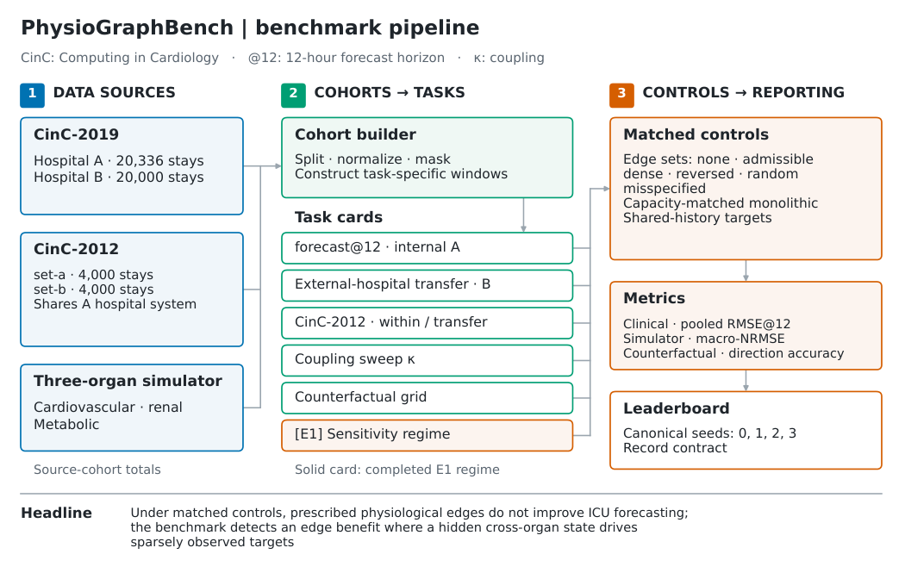

# PhysioGraphBench: when do physiological graph priors help?

**Version 1.1.2 — documentation synchronization with the v5 findings.** This
update preserves the code, results and tests in v1.1.0 (source commit
[e7e290742b3756fb03462ffde8a3d3ecc4bf5584](https://github.com/wwhite777/physiographbench/tree/e7e290742b3756fb03462ffde8a3d3ecc4bf5584)).
The concept DOI is [10.5281/zenodo.23976171](https://doi.org/10.5281/zenodo.23976171);
the v1.1.0 record is [10.5281/zenodo.23992302](https://doi.org/10.5281/zenodo.23992302).
The selected per-seed checkpoints (140 fits) are archived in a separate Zenodo
checkpoints record, [10.5281/zenodo.23993257](https://doi.org/10.5281/zenodo.23993257), described below.
No v1.1.1 or v1.1.2 archival record of the code is asserted by this update.
Version 1.1.2 corrects one budget-control interpretation; see
[the 1.1.2 note](docs/RELEASE_V1_1_2.md).

**At the 35-epoch cap, the shared-input no-edge organ model trails GRU-D;
a 70-epoch budget largely closes that gap. Prescribed edges show no consistent
clinical benefit, while a registered synthetic sensitivity regime detects one.**

This benchmark release supplies the simulator, cohort builders, baselines,
protocols and frozen results for evaluating physiological graph priors. It
separates edge choice, model architecture, input access and evaluation protocol
in intensive care unit (ICU) forecasting. The findings concern the tested prediction tasks and implementations. They do
not establish clinical utility or validate recovered edges as causal physiology.

Figure 1 summarizes the v5 pipeline, clinical forecasting and separate simulated
intervention experiments. The clinical models use four organ groups; the
simulator uses three. Zero simulator coupling retains a shared sepsis course.

## Leaderboard and record contract

The [clinical leaderboard](leaderboard/LEADERBOARD.csv) contains 400 seed/split
records covering the selected clinical models, learned graphs, shared-input
primary arms, longer-budget controls and CinC-2012 within/transfer protocols.
The [record contract](leaderboard/RECORD_SCHEMA.json) specifies configurations,
checkpoint provenance, metrics, denominators and exact source-record pointers.
The weight files themselves are not in this repository: the 140 selected
per-seed checkpoints (Table 1 architectures, learned graphs, shared-input
arms, budget controls and the earlier fixed-configuration diagnostics, seeds
0–3) are published as a separate Zenodo checkpoints record,
[10.5281/zenodo.23993257](https://doi.org/10.5281/zenodo.23993257), with a manifest keyed by
series, arm and seed, a loading script and its own README.
[Build and comparison instructions](leaderboard/README.md) explain canonical
seeds 0–3, pooled RMSE@12, fixed splits and exclusion labels. Also included are
the [shared-input arm inventory](experiments/shared_input_primary/E2_arm_inventory.json)
and the [preserved scientific appendix](docs/README_APPENDIX.md).

## Main findings

The clinical task observes a 12-hour context and predicts the next 12 hours.
Root mean squared error (RMSE) is pooled over observed target entries after
normalization by training-cohort statistics; lower is better. In the Computing
in Cardiology (CinC) 2019 corpus, set A is internal and set B is external.
The primary organ model is shared-input PhysioGraph-GRU: every organ node
receives all 16 dynamic variables and their observation masks. GRU denotes a
gated recurrent unit; GRU-D adds decay for missing measurements. The historical
organ-partitioned model remains an input ablation.

The main comparison uses the same learning-rate × width grid, A-validation
selection and 35-epoch cap for recurrent and organ models. The shared-input
selection is learning rate 0.001 and large width (96). The cap specifies equal
maximum epochs, rather than equal convergence. Means below use four seeds;
Δ is model minus GRU-D, with a 95% paired Student-t confidence interval (CI)
over the four recorded seed pairs. Positive Δ means higher error.

| Model, 35-epoch cap | Internal A RMSE | External B RMSE | Δ vs GRU-D, A [95% paired CI] | Δ vs GRU-D, B [95% paired CI] |
|---|---:|---:|---|---|
| GRU-D (449,568 parameters) | 0.7458 | 0.8059 | reference | reference |
| PhysioGraph-GRU shared, no edges (778,384) | 0.7559 | 0.8088 | +0.0101 [+0.0072, +0.0130] | +0.0029 [+0.0003, +0.0056] |
| PhysioGraph-GRU shared, admissible edges (930,464) | 0.7551 | 0.8093 | +0.0093 [+0.0053, +0.0132] | +0.0034 [−0.0005, +0.0073] |
| t-PatchGNN, paper settings | 0.7492 | 0.7939 | see paired-statistics records | see paired-statistics records |
| GraFITi, paper settings | 0.7483 | 0.7932 | see paired-statistics records | see paired-statistics records |

The shared no-edge deficit is positive in 4/4 paired seeds on both cohorts.
The primary numbers, selection and contrasts are in
[the shared-input reading](experiments/shared_input_primary/artifacts/host/E2_E4_READING.md)
and [summary JSON](experiments/shared_input_primary/artifacts/host/e2_e4_summary.json).
t-PatchGNN and GraFITi use declared paper settings without a grid; their lower
external errors compare these implementations and tuning conventions. Shared
no-edge minus GraFITi is +0.0156 [+0.0126, +0.0186] on B; minus t-PatchGNN is
+0.0149 [+0.0124, +0.0174]. The implementations and adaptations are described in
[baselines/METHODS.md](baselines/METHODS.md).

For context, the historical CinC-2019 capacity controls give plain GRU
(444,944 parameters) 0.7489 / 0.8059 A/B, GRU-med (2,586,896) 0.7475 / 0.8068
and GRU-large (6,498,320) 0.7533 / 0.8104. Those wider GRUs do not improve on
GRU-D on this primary cohort; selected GRU-med is not parameter-matched. This
capacity statement does not extend to CinC-2012 or the at-least-48-hour horizon
cohort, where wider GRUs can be as good or better. The historical partitioned
organ model is 0.7702 / 0.8177 with admissible edges (912,032 parameters), and
its paired per-stay gaps versus GRU-D are 0.0198 ± 0.0022 A / 0.0115 ± 0.0007 B.
Those per-stay averages have a different estimand from pooled RMSE differences;
see [historical statistics](results/v4/stats_v4.json).

The budget control is a separate series, compared with GRU-D at the same cap:

| Model, 70-epoch cap | Internal A RMSE | External B RMSE | Δ vs same-cap GRU-D, A [95% paired CI] | Δ vs same-cap GRU-D, B [95% paired CI] |
|---|---:|---:|---|---|
| PhysioGraph-GRU shared, no edges | 0.7496 | 0.8070 | +0.0007 [−0.0030, +0.0044] | −0.0026 [−0.0088, +0.0036] |
| PhysioGraph-GRU shared, admissible edges | see budget records | see budget records | +0.0088 | +0.0053 |

From the 35-epoch to the 70-epoch cap, the no-edge deficit versus GRU-D moves
from +0.0101 to +0.0007 on A and from +0.0029 to −0.0026 on B; it narrows in
4/4 seeds, and both 70-epoch intervals include zero. The narrowing has two
parts: the no-edge model improves (A 0.7559 → 0.7496, B 0.8088 → 0.8070) and
GRU-D worsens (A 0.7458 → 0.7489, B 0.8059 → 0.8096); on B the GRU-D change is
the larger part. The cap, the cosine learning-rate schedule and early stopping
change together, so this is a sensitivity to those training choices, not an
isolated attribution to training duration. The admissible-edge model does not
close the gap, and both organ models worsen at 105 epochs (validation early
stopping in 4/4 seeds); a longer cap does not guarantee lower error. Full paired intervals for all
budget arms are in the [budget reading](experiments/shared_input_primary/artifacts/host/E2_E4_READING.md).

On CinC-2012, the retained historical experiments use the partitioned-input
organ model, rather than the separately retuned shared-input primary. Transfer
evaluates CinC-2019-trained models with CinC-2019 training normalization on
set-a and set-b, pooling 7,982 eligible stays. Within-corpus training uses set-a
(3,390 training / 599 validation stays), CinC-2012 training normalization and
the CinC-2019-selected configurations, then evaluates set-b (3,993 eligible
stays). The 16-variable protocol is shared.

| Model | CinC-2012 transfer, pooled | CinC-2012 within, set-b | Frozen source |
|---|---:|---:|---|
| GRU-D | 0.8273 ± 0.0018 | 0.7684 ± 0.0018 | [Result table](results/clinical_v4_v1/cinc2012/TABLE_CINC2012.md) |
| PhysioGraph-GRU, historical partitioned input | 0.8529 ± 0.0020 | 0.8239 ± 0.0152 | [Result table](results/clinical_v4_v1/cinc2012/TABLE_CINC2012.md) |
| t-PatchGNN | 0.8142 ± 0.0005 | 0.7460 ± 0.0029 | [Result table](results/clinical_v4_v1/cinc2012/TABLE_CINC2012.md) |
| GraFITi | 0.8192 ± 0.0059 | 0.7335 ± 0.0017 | [Result table](results/clinical_v4_v1/cinc2012/TABLE_CINC2012.md) |

These spreads are sample standard deviations over four seeds. Recurrent-over-
partitioned-organ and learned-graph orderings recur; margins differ by comparator
and protocol. The corpus shares hospital-system provenance with CinC-2019 set A;
patient overlap cannot be excluded or measured without cross-corpus identifiers.
Its set-a and set-b are not asserted to be different hospitals. Arterial oxygen
saturation (SaO2) stands in for pulse-oximetry oxygen saturation (O2Sat).

For the simulator, macro normalized RMSE (macro-NRMSE) averages organ errors
after division by fixed reference ranges. Counterfactual recurrent network
(CRN)-lite is a gradient-reversal surrogate, distinct from the continuous-dose
CRN adaptation. The state-space model (SSM) uses a different recurrence from GRU.

| Question | v5 finding and scope | Frozen evidence |
|---|---|---|
| Do imposed edge sets distinguish clinical performance? | On the retuned shared-input primary backbone, no edge set is consistently better than no edges. Admissible minus none is −0.0009 [−0.0062, +0.0045] on A and +0.0005 [−0.0042, +0.0051] on B. All primary edge-versus-none intervals except dense-on-B include zero; random-versus-admissible intervals all include zero. Dense-on-B is +0.0021 [+0.0000, +0.0042] (unrounded lower bound positive). These results do not establish statistical equivalence. | [Primary edge reading](experiments/shared_input_primary/artifacts/host/E2_E4_READING.md) |
| Are normalization and capacity isolated? | The normalization-retaining no-edge arm costs +0.0026 [+0.0008, +0.0043] on A and +0.0008 on B relative to raw none; therefore none-versus-edges includes a normalization effect. Parameter-matched none (930,464 parameters) differs from raw none by +0.0004 A / −0.0003 B. The historical partitioned GRU has admissible lowest, while its state-space counterpart has none lowest; those ablations remain historical. | [Primary controls](experiments/shared_input_primary/artifacts/host/E2_E4_READING.md), [historical variants](results/v4/variant_ablation_v4.json) |
| What explains the renal deficit? | The post-hoc fixed-configuration diagnostic gives all nodes all inputs: renal RMSE changes 0.846332 → 0.712003 on A and 1.067043 → 0.939610 on B, improving in 4/4 paired seeds on each cohort and crossing below persistence. This supports an input-partition finding with projection-capacity qualifications. In the retuned primary series every edge set raises mean renal RMSE (A none 0.698 → 0.728–0.741), while all arm means beat renal persistence. | [Renal diagnostic](diagnostics/renal_shared_input/SHARED_INPUT_READING.md), [primary renal results](experiments/shared_input_primary/artifacts/host/E2_E4_READING.md) |
| What does the historical simulator comparison show? | At κ = 1: capacity-matched monolithic GRU 0.0389 → organ architecture without edges 0.0364 → admissible edges 0.0377. These complete implementations differ in readout, state layout and normalization; the means do not isolate factorisation. Admissible edges have higher observed error at five of six κ values and nearly equal means at κ = 0.75: paired difference −0.00000813 [−0.00097537, +0.00095912], two negative and two positive seeds. At κ = 1 the admissible-minus-none gap is +0.0012 [−0.0006, +0.0031]. | [Matched controls](results/sim_grids_v1/h3_grid_with_controls.json), [paired contrasts](analysis/paired_statistics/PAIRED_STATS_v5.md) |
| Can the benchmark detect a prescribed-edge benefit? | Registered positive-control **PASS**: with a hidden cardiovascular perfusion-reserve drive, transport delays and sparse/noisy renal and metabolic observations, comparator minus admissible macro-NRMSE at κ = 1 is +0.0160 [+0.0142, +0.0179] for none, +0.0167 [+0.0142, +0.0192] for reversed and +0.0117 [+0.0027, +0.0208] for random, positive in 4/4 seeds each and non-decreasing over κ = 0, 0.5, 1. Oracle gains are 21% renal / 29% metabolic. The full-input monolithic GRU is descriptively similar (0.0798 vs 0.0800); this shows recovery of missing cross-organ information, without establishing superiority over full-input forecasting. Scope: one generated population, four training/split seeds and artificial drive/delays; no clinical edge benefit is claimed. | [Registered regime and results](experiments/positive_control/) |
| When are onset-matched counterfactual directions recovered? | At fixed severity–dose Spearman correlation 0.300, widening within-tercile dose support raises post-effect accuracy: Control-GRU 0.347 → 0.909, CRN-lite 0.342 → 0.909, organ GRU 0.310 → 0.897 and organ state-space model 0.355 → 0.890. Paired endpoint gains +0.54 to +0.59 have 95% CIs excluding zero, in 4/4 seeds. At fixed within-tercile support, dependence reaches only 0–0.30: Control-GRU changes 0.991 → 0.909 (−0.083 [−0.179, +0.013]) and organ GRU 0.964 → 0.897 (−0.067 [−0.135, +0.000]); both intervals include zero. | [Onset-matched policies](experiments/counterfactual_onset_matched/artifacts/host/E3_READING.md) |
| Does treatment balancing rescue direction recovery? | Repaired counterfactual recurrent network (CRN)-lite uses a varying eventual-dose target; every paired post-effect interval versus Control-GRU includes zero. The continuous-dose CRN trails its matched Control-GRU on the identical onset-matched randomised-dose set in all six λ/epoch arms and 4/4 seeds (paired accuracy CIs below zero). This is a failed estimator in this matched synthetic task. The older CRN-lite target is constant zero, and the older continuous-dose diagnostic mismatches treatment onset; those historical diagnostics cannot establish balancing success or attribute failure solely to the estimator. | [Main reading](experiments/counterfactual_onset_matched/artifacts/host/E3_READING.md), [matched-control addendum](experiments/counterfactual_onset_matched/artifacts/host/E3_READING_ADDENDUM.md), [legacy CRN sweep](results/learned_graph_baselines_v1/crn_v2_lambda_sweep/) |
| Does GraFITi reproduce its published protocol? | The 37-variable PhysioNet-2012 protocol (12,000 records, 36 h observation → next three recorded steps, pooled observed-cell mean squared error) reaches test MSE 0.3027 versus published 0.286 ± 0.001: +0.0167 (+5.8%). One seed, 44,744 parameters and best epoch 84 reach the regime without matching published precision. Split/fold, optimizer and preprocessing differences are recorded without attributing the gap. | [Protocol and reading](experiments/learned_graph_validation/) |
| Does learned topology explain the learned models' advantage? | Replacing learned adjacency with physiological, random or complete graphs leaves GraFITi A-test RMSE nearly unchanged (0.7482–0.7483 vs 0.7483 learned); t-PatchGNN rises by +0.0025 to +0.0046 from 0.7492. These four-seed ablations limit topology attribution; the external implementation advantage cannot be assigned to a specific learned graph. | [Adjacency reading and paired intervals](experiments/learned_graph_validation/artifacts/E5_READING.md) |
| How much next-hour cross-organ predictive gain is observed? | Ridge gain on A validation is +0.0033 [0.0023, 0.0043]; none is positive on B (mean −0.0557 [−0.1352, −0.0002], driven by individual stays in two cells). The GRU probe is −0.0048 on A validation / −0.0063 on B. Coupled hourly simulator settings score 0.17–0.21 on the same definition; no numerical mapping onto κ is claimed. | [Clinical index](results/coupling_index_v1/coupling_index.json), [hourly simulator](results/coupling_index_v1/simulator_hourly/sim_hourly_index.json) |
| Does the historical external graph gap close with horizon? | For the partitioned-input series, a 12-hour context on the common cohort with at least 48 hours gives organ-minus-GRU-D gaps +0.026 at horizon 6, +0.021 at 12 and +0.019 at 24. This is not a horizon evaluation of the retuned shared-input primary. | [Historical horizon table](results/v4/horizon_table_v4.json) |
| Can the cohort be rebuilt? | All 40,336 public raw files are included, with zero exclusions. Rebuilding reproduces the complete CinC-2019 archive bytes. Both CinC-2012 cohort views have expected archive and per-array hashes. | [Replay](results/cohort_replay_v1/REPLAY_RESULTS.json), [cohort hashes](manifests/cohorts.json) |
| What is withheld from confirmed rankings? | Neural controlled differential equation (CDE) external checkpoint replay on CinC-2019 is unresolved. Saved external errors are finite (3.4459 ± 3.2320); CPU replay disagrees, and no divergence threshold was recorded. These remain archival diagnostics, excluded from confirmed external rankings. Finite CinC-2012 results remain in the full table and do not resolve that replay. | [CDE diagnostic](results/v4/ncde_diagnosis.md), [CinC-2012 table](results/clinical_v4_v1/cinc2012/TABLE_CINC2012.md) |

The simulator score is a macro-average of organ errors normalized by one fixed
reference range (macro-NRMSE), distinct from clinical pooled RMSE. κ scales the
tested coupling terms. The sensitivity regime uses its own fixed reference
ranges, so its absolute scores are not on the historical simulator's scale.
Direction recovery means recovering the sign of the simulated response to
adjacent doses. The onset-matched experiments hold the factual history fixed,
start alternative doses at the factual minute-72 onset and score minutes 75–175
(60,480 post-effect cells per run).

The legacy shared-history c × σ grid is retained as a historical diagnostic:
c controls severity-dependent dosing, and σ is the Gaussian assignment-noise
standard deviation. At σ = 0 the uniform random-dose component (1 − c)u remains
for c < 1; dosing is deterministic given severity only at c = 1. All four
historical primary models recover three population directions at c ≤ 0.1, two
at c = 0.25 and none at c ≥ 0.5. Adding noise changes both support and
severity–dose dependence, so that grid cannot separate their effects. At c = 1,
σ = 0.25, mean arterial pressure and urine-output direction accuracy rounds to
at least 0.93 (minimum 0.927365); lactate is lower (0.18–0.50), and overall
cellwise accuracy is 0.805–0.861. At σ = 0.15 organ-model accuracy can be
0.60–0.76 while GRU-family accuracy is 0.86–0.90. The legacy counterfactual
switch is minute 60, factual treatment begins at minute 72, and one pre-switch
target sample caps exact-sign accuracy at 0.965. Randomising eventual dose
independently of severity leaves that onset mismatch. It does not by itself
identify an earlier-start intervention; a structural assumption and adequate
state–dose support would be needed. Missing legacy predicted trajectories
prevent exact post-effect rescoring of those records.

## Data and licences

| Resource | Access | Data licence | Reproduction |
|---|---|---|---|
| CinC-2019 sepsis challenge, version 1.0.0 | [PhysioNet](https://physionet.org/content/challenge-2019/1.0.0/), [public S3 mirror](https://physionet-open.s3.amazonaws.com/) | [CC BY 4.0](https://creativecommons.org/licenses/by/4.0/) | `python3 tools/fetch_s3_cinc2019.py --root data` |
| CinC-2012 challenge, version 1.0.0 | [PhysioNet](https://physionet.org/content/challenge-2012/1.0.0/) | [ODC-By 1.0](https://opendatacommons.org/licenses/by/1-0/) | `python3 tools/fetch_cinc2012.py --root data/cinc2012` |
| Simulator and benchmark software | This repository | [MIT](LICENSE) | `python3 tools/replay_simulators.py --group all --run` |

Data attribution: PhysioNet/Computing in Cardiology Challenge 2019, Early Prediction
of Sepsis from Clinical Data; PhysioNet/Computing in Cardiology Challenge 2012,
Predicting Mortality of ICU Patients. Preserve the original dataset attribution
and applicable data terms when obtaining or reusing the corpora. The MIT software
licence does not replace the upstream data licences. No raw patient data are
redistributed here, and no model weights are in this repository; the selected
checkpoints are in the separate Zenodo checkpoints record [10.5281/zenodo.23993257](https://doi.org/10.5281/zenodo.23993257).

## Run the artifact

Use Python and the package versions in [requirements.txt](requirements.txt).
The recorded environment is [manifests/environment.json](manifests/environment.json).
From the repository root:

```bash
make smoke
python3 tools/summarize_results.py --out-dir runs/tables
python3 -c "import json; assert json.load(open('runs/tables/findings.json')) == json.load(open('results/findings.json'))"
python3 tools/cinc2012/host_driver.py --dry-run --device cpu --threads 1
python3 tools/cinc2012/aggregate_cinc2012.py \
  --from-summary results/clinical_v4_v1/cinc2012/cinc2012_results.json \
  --out-table runs/tables/TABLE_CINC2012.md
```

The download, cohort rebuild, simulator generation, experiment, table and figure
routes are in [REPRODUCE.md](REPRODUCE.md), including expected hashes. The legacy
table/plot tools reconstruct v4 displays; the JSON assertion above checks their
values against the frozen findings. The legacy `make findings` / summarizer
`--check` route also requires the old README table verbatim, so it does not
validate this updated README. The primary v5 records and limitations are linked above. [Release notes](docs/RELEASE_V1_1_1.md) explain this boundary.
`PHYSIOGRAPH_ROOT` can select the repository root; `TMPDIR` selects private scratch.
The historical v4 experiment outputs go to `runs/`, with generated-data and probe caches
in ignored `data/` and `artifacts/` locations. `results/` holds the frozen records. `SHA256SUMS` checks the exact public distribution. Historical source and
archive fingerprints are retained separately from distribution fingerprints.

CinC-2012 table reconstruction uses the shipped per-seed records and requires
no training. Its [drivers and 88-command manifest](tools/cinc2012/README.md)
also support retraining and transfer evaluation after the cohorts and CinC-2019
source checkpoints are rebuilt. `make cinc2012-smoke` runs one 64-stay,
one-epoch CPU fit after cohort rebuilding; a clean distribution explicitly
skips transfer smoke because weights are not shipped in the repository. The full prerequisites,
CPU/GPU launch commands and aggregation are in [REPRODUCE.md section 3](REPRODUCE.md#3-reconstruct-the-cinc-2012-table-or-retrain-from-open-cohorts).

| Directory | Contents |
|---|---|
| `src/` | Original organ model, clinical baselines, loader, cohort parser, simulator, and supporting legacy entry points |
| `tools/` | Portable v4 protocol, cohort/replay utilities, statistics, coupling index, experiment plans, table/plot generation |
| `tools/cinc2012/` | CinC-2012 within-corpus training, frozen-source transfer, 88-run launcher and table/error aggregation |
| `sim/` | Matched edge controls, shared-history generation, monolithic controls, grid aggregators |
| `baselines/` | Paper-based variable-graph and continuous-dose CRN adaptations |
| `results/` | Frozen numerical evidence and machine-generated display tables |
| `manifests/` | Generation settings, original/distributed hashes, environment, cohort and simulator array checks |

## Limitations

The post-hoc [renal shared-input diagnostic](diagnostics/renal_shared_input/)
was run after the results and blind reviews were seen, at one fixed configuration
without retuning over four paired seeds, with no significance test. Sharing
inputs adds 18,432 projection parameters, so input access is not separated from
that capacity change. B cardiovascular error rises in 2/4 pairs. Optimization,
forecast-boundary handling and missingness representation (including absent
elapsed-time input) remain untested alternatives. This diagnostic is not a new
proposed model and is not ranked against the primary table. The same fixed-configuration control lowers pooled error
from 0.772360 to 0.757969 on A and 0.818781 to 0.810142 on B in 4/4 pairs.
These diagnostic values use the old selection and do not substitute for the
independently selected primary numbers. The separately
retuned shared-input series above is the primary comparison.

The post-hoc [shared-input edge ablation](diagnostics/shared_input_edges/)
was run after the round-2 reviews at the configuration tuned on partitioned
inputs, with four seeds and no significance test. Random edges lower pooled
A error most; none is lowest on B. Every nonempty edge set raises renal error
in 4/4 paired seeds on both cohorts; message capacity differs across variants.
This fixed-configuration diagnostic is distinct from the retuned primary
edge series and is not ranked against the primary table.

The simulator findings come from one simulator family with three organ groups:
cardiovascular, renal and metabolic. This structure-matched setting does not
establish generality across physiological simulators or all organ systems.

Clinical forecasting does not observe treatments in CinC-2019. Counterfactual
claims therefore refer to the simulator. The simulator contains cardiovascular,
renal and metabolic groups, a step onset of sepsis, and a shared sepsis course
even at κ = 0. Its extended hourly trajectories can reach nonphysiological
states; the hourly index is descriptive calibration and does not validate the
simulator or locate the clinical data on a causal coupling scale.

The clinical forecasting protocol contains no real treatment variables or
interventions; treatment-direction claims are confined to simulated outcomes.
Each reported comparison uses four seeds. Seed standard deviations summarize
that limited set of runs and do not establish broad robustness. Paired intervals
measure seed/split variation conditional on the observed cohort; they do not
supply independent patient-population replication. Neural CDE external
CinC-2019 checkpoint replay is unresolved; its finite saved errors are retained
as archival diagnostics and excluded from confirmed rankings. Finite CinC-2012
runs do not resolve that disagreement.

The learned variable graphs use paper hyper-parameters without a tuning grid,
whereas the recurrent and organ-graph models use equal-budget validation tuning.
Their rankings compare these implementations and settings, rather than an equal
search over every model family. Within-corpus CinC-2012 configurations were
selected on CinC-2019 and were not re-tuned on CinC-2012. The hospital-system
overlap and measurement substitutions described above limit claims of
independent clinical generalization. The historical within-corpus organ fits
are the least seed-stable, with bimodal seed outcomes. Patient overlap between the two corpora
cannot be excluded or measured.

The original simulator's urine output is a memoryless logistic function of mean
arterial pressure (MAP), and lactate has a one-state pressure/sepsis-driven
ordinary differential equation without feedback into circulation. Much edge
information is recoverable from each organ's own history. The registered
positive control tests one artificial hidden-state/transport-delay regime with
four training/split seeds; it does not establish general simulator sensitivity
or clinical edge benefit.

The separate dependence-only family reaches rank correlations only from 0 to
0.30 because identical conditional dose distributions cap attainable dependence.
Severe deterministic dependence appears only in the legacy joint grid, which
also changes dose support. Severity-tercile coverage does not prove conditional
positivity or adequate state–dose support.

The counterfactual provenance audit records four dataset-hash discrepancies
across three historical training archives. Earlier training arrays were
unavailable. Matching saved predictions and test truth does not establish that
historical training arrays were identical. The discrepancies remain unresolved;
the onset-matched score checks do not certify historical training provenance.

Two lineage disclosures affect interpretation of the earlier results.
The earlier counterfactual targets received treatment since warm-up and did not
share the factual history. v4 branches from the factual state at the future
intervention time. Severity–dose correlations are measured per file; the policy
noise term is retained. The previously reported per-window interval came from a
checkpoint pair that was later overwritten. v4 saves seed-specific checkpoints
when rerun and distinguishes seed variation from paired patient sampling
uncertainty. Historical diagnostics and their exception remain in the frozen run
manifest; they are not silently relabelled as new evidence.

The cohort uses numerical units as distributed: inspired oxygen fraction (FiO2)
is fraction-valued; lactate is on the mmol/L numerical scale despite conflicting
upstream descriptions. The CinC-2012 report documents its hourly pressure
fallback, modality differences, missing static covariates, and evaluation-only
transfer view. These are reproducible measurement and protocol choices rather
than evidence of clinical interchangeability.

Code and data transformations for distribution preserve numerical results and
record both original and distributed v1.1.0 file hashes in
[manifests/distribution.json](manifests/distribution.json). For the current edited
Markdown and overview PNG, use `SHA256SUMS`; the historical JSON inventory and
README trace are preserved as v1.1.0 records, as explained in the
[release notes](docs/RELEASE_V1_1_1.md). Simulator metadata
contains new paths and code fingerprints, so the portable archive bytes can
differ while every scientific array is checked against frozen payload hashes.

The data are public and de-identified; re-identification and treatment use are
outside scope. Subgroup fairness has not been validated. Source licences govern
reuse, and the simulator is a methodological stress test rather than
patient-specific advice. No clinical treatment-effect or decision-benefit
evidence is established.

## Citation

Code and results: [PhysioGraphBench](https://github.com/wwhite777/physiographbench).
Concept DOI: [10.5281/zenodo.23976171](https://doi.org/10.5281/zenodo.23976171).
The v1.1.0 record is [10.5281/zenodo.23992302](https://doi.org/10.5281/zenodo.23992302).
The checkpoints record (140 selected per-seed fits, v1.1.0) is [10.5281/zenodo.23993257](https://doi.org/10.5281/zenodo.23993257).

```bibtex
@software{jeong2026physiographbench,
  author    = {Jeong, Woncheol and Oh, Hayoung},
  title     = {PhysioGraphBench: code, results and diagnostics for a matched-control benchmark of physiological graph priors in multi-organ ICU trajectory forecasting},
  year      = {2026},
  publisher = {Zenodo},
  doi       = {10.5281/zenodo.23976171},
  url       = {https://github.com/wwhite777/physiographbench}
}
```

Software is distributed under the [MIT licence](LICENSE).


## Round-4 experiments

- [experiments/positive_control/](experiments/positive_control/): registered delayed-drive positive control, 96 fits and three synthetic datasets.
- [experiments/shared_input_primary/](experiments/shared_input_primary/): shared-input selection, graph/capacity arms and longer training budgets, 70 fits.
- [experiments/counterfactual_onset_matched/](experiments/counterfactual_onset_matched/): onset-matched support/dependence families, CRN diagnostics and matched controls, 188 records.
- [experiments/learned_graph_validation/](experiments/learned_graph_validation/): GraFITi P12 reproduction attempt and 24 fixed-graph fits.
- [analysis/paired_statistics/](analysis/paired_statistics/): 641 four-seed paired contrasts, multiplicity families, bootstrap summaries and stated missing-prediction limitations.

Recorded compute and coverage are in [docs/COMPUTE.md](docs/COMPUTE.md).
The documentation update is version **1.1.2**, built on the unchanged **1.1.0**
source/result distribution. No model training is needed
to inspect these records or enumerate any run plan. Per-folder READMEs give
rerun prerequisites and expected numbers. These additions retain their stated
scientific and provenance qualifications.

For verification without optimizer steps, set `PHYSIOGRAPH_NO_TRAINING=1` before
`make smoke` or the experiment test suites. The inherited synthetic fitting test
and the three optional experiment fitting tests then report explicit skips.
