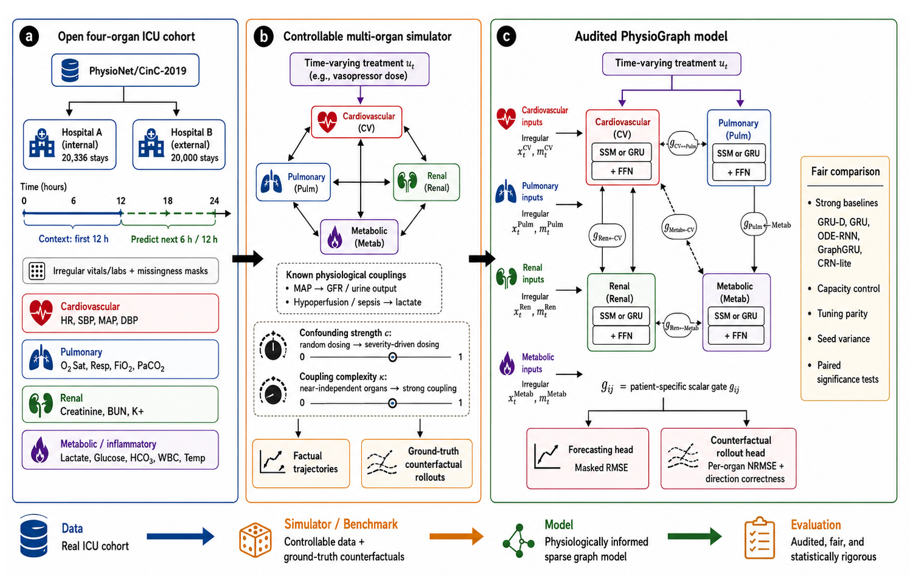

# PhysioGraphBench: When Do Physiological Graph Priors Help?

*A Reproducible, Baseline-Aware Benchmark for Multi-Organ ICU Trajectory Mining*



**Encoding the body as a graph of coupled organs sounds obviously right. Measured
against tuned recurrent baselines under an identical budget, it makes short-horizon
ICU forecasting *worse* — external RMSE 0.820 for the organ-graph model against
0.806 for GRU-D, a gap that holds across every seed (paired *t* = 13.82,
*p* = 8.2e-4) and across 2,368 held-out windows (Wilcoxon *p* = 4.3e-53).**

This repository is the benchmark, the simulator, the baselines and every frozen
result behind that sentence. It is **not** a method release: the model we audit
loses, and the point of the artifact is that the loss is measured properly.

---

## The short version

Multi-organ failure is coupled: falling blood pressure starves the kidney, poor
perfusion drives lactate. So the natural modelling move is to write that anatomy
down — organs as nodes, known physiological influences as edges — and pass
messages only along admissible paths. The prior is free, interpretable, and
almost universally assumed to help. We built the fairest test we could and it
does not help.

| question | answer | evidence |
|---|---|---|
| beats a plain GRU on the external cohort? | **no** | 0.820 vs 0.808 |
| explained by too few parameters? | **no** | loses to a 124k GRU *and* a capacity-matched 679k GRU (*p* = 2.6e-4) |
| does the *correct* edge direction beat its reverse? | **no** | 0.8243 vs 0.8232 |
| does any graph beat no graph at all? | **no** | no-graph 0.8196 is the most accurate variant |
| does it ever help? | **yes, narrowly** | ~14% better on a simulator with strong organ coupling |

What the graph reliably buys is **robustness and readability, not accuracy**: it
has the smallest internal-to-external degradation of any model (5.9% vs 7.2–8.0%)
while remaining the *worst* model in absolute external terms, and its learned edge
gates are extremely stable under bootstrap resampling.

## The organ graph

**Nodes — 4 organ systems, 16 variables** (`organ_dims = (4, 4, 3, 5)`):
*cardiovascular* (HR, SBP, MAP, DBP), *pulmonary* (O2Sat, Resp, FiO2, PaCO2),
*renal* (creatinine, BUN, potassium), *metabolic-inflammatory* (lactate, glucose,
HCO3, WBC, temperature).

**Edges — 8 hand-specified, physiologically admissible, directed:** CV→Renal
(MAP→GFR), CV→Pulm, CV→Metab, Pulm→CV, Pulm→Metab, Metab→CV, Renal→Metab,
Renal→CV. Every non-admissible edge is masked to zero. **That sparsity pattern is
the prior under audit.**

**Node model.** Each organ is a compact diagonal complex state-space (LRU-style)
cell with a provably stable pole `λ = exp(−exp(ν) + iθ)`, *or* a GRU cell
(`node_type = "ssm" | "gru"`). Both backbones are reported, so a weak node model
cannot be confused with a bad graph. Messages travel only along admissible edges,
each modulated by a per-patient scalar gate — an organ-level mixture of experts.
Time-varying treatments are injected into the latent dynamics, so one model both
forecasts (controls = 0) and rolls out interventional counterfactuals by
free-running g-computation. 0.1–0.9M parameters.

**Protocol.** Masked MSE (errors scored only over observed entries), Adam, cosine
schedule, 35-epoch cap, early stopping — **identical budget for every model**.
Normalisation is fit on the internal training split only.

## Results: the prior does not help

CinC-2019, 12h context → 12h horizon, normalised RMSE@12, mean ± std over 4 seeds.
Set A is internal, set B is a **different hospital system**. Lower is better.
*(`result/forecast_seed_stats.json`)*

| model | params | internal A | external B | drop |
|---|---:|---|---|---:|
| GRU-D | 126,624 | **0.748 ± 0.001** | **0.806 ± 0.001** | 7.8% |
| GRU-med | 679,056 | 0.750 ± 0.001 | 0.808 ± 0.001 | 7.7% |
| GRU | 124,176 | 0.753 ± 0.000 | 0.808 ± 0.000 | 7.3% |
| GRU-large | 1,676,304 | 0.751 ± 0.001 | 0.811 ± 0.001 | 8.0% |
| ODE-RNN | 157,200 | 0.757 ± 0.001 | 0.813 ± 0.001 | 7.4% |
| GraphGRU | 211,056 | 0.761 ± 0.002 | 0.816 ± 0.001 | 7.2% |
| **PhysioGraph (GRU)** | 912,032 | 0.774 ± 0.002 | 0.820 ± 0.002 | **5.9%** |
| **PhysioGraph (SSM)** | 687,008 | 0.778 ± 0.001 | 0.826 ± 0.002 | 6.1% |
| persistence | 0 | 0.875 | 0.932 | 6.5% |

PhysioGraph has the **best relative cross-cohort drop and the worst absolute
external error**. The ordering is stable and is not a capacity artifact: vs GRU-D,
paired *t* over 4 seeds **t = 13.82, p = 8.20e-4**; across 2,368 test windows mean
gap **0.02531**, bootstrap 95% CI **[0.0220, 0.0285]** (excludes zero), **Wilcoxon
p = 4.30e-53**, better on only 36.7% of windows; vs the capacity-matched GRU-med
**t = 20.34, p = 2.60e-04**. Neural-CDE diverged on the external cohort and is
excluded rather than reported as a favourable comparison.

**Does the graph structure matter at all?** *(`result/h4_falsification.json`,
`result/thm3_sparsity.json`, 2 seeds)*

| edge set | external RMSE |
|---|---|
| no graph | **0.8196 ± 0.0002** |
| reversed edges | 0.8232 ± 0.0001 |
| admissible (physiologically correct) | 0.8243 ± 0.0004 |
| fully connected (dense) | 0.8245 ± 0.0012 |
| random edges | 0.8349 ± 0.0060 |

Coherent structure beats random structure — but **the physiologically correct
direction is no better than its exact reverse**, and removing the graph is best of
all. Sparse is ~2.9× more seed-stable than dense; it is not more accurate.
**Forecasting accuracy does not certify edge direction** — a caution for any paper
claiming to have "discovered" physiology from predictive gain.

## When it *does* help

**H3 — organ coupling: POSITIVE.** Sweeping simulator coupling complexity κ,
macro-NRMSE *(`result/tier2_sweeps.json`)*:

| κ | PhysioGraph-GRU | Control-GRU | relative |
|---|---|---|---|
| 1.0 | **0.0454** | 0.0530 | 14.3% better |
| 0.5 | **0.0503** | 0.0590 | 14.7% better |
| 0.0 | 0.5787 | 1.8930 | *degenerate — the decoupled renal compartment is near-unpredictable for both* |

At κ = 1.0 the gain lands exactly where theory predicts, on the **downstream**
organs: renal 0.0534 vs 0.0630, metabolic 0.0582 vs 0.0676, while the upstream
cardiovascular node barely moves. **When cross-organ coupling is genuinely strong,
the graph earns its keep.** Real ICU data at a 12h horizon is not that regime.

**H2 — low data: NEGATIVE.** The usual defence of a structural prior is that it
helps when data is scarce. The opposite happens; the deficit *grows* as data
shrinks: 0.0175 (100%) → 0.0178 → 0.0227 → 0.0264 → **0.0271** (5%).

**H1 — horizon: WEAK.** The gap narrows at longer horizons (0.0145 at C12/K12 →
0.0056 at C12/K24) but never reverses.

## Every model gets the treatment direction wrong — and we show why

On the CVSim counterfactual benchmark we sweep a vasopressor dose grid and ask
whether models get the *direction* of the response right.
*(`result/cvsim_counterfactual.json`)*

| model | macro NRMSE | cardiac | renal | metabolic | correct directions |
|---|---|---|---|---|---|
| Control-GRU | **0.074** | 0.039 | 0.088 | 0.095 | **0/3** |
| CRN-lite (causal adjustment) | 0.075 | 0.039 | 0.088 | 0.097 | **0/3** |
| PhysioGraph (GRU) | 0.087 | 0.040 | 0.096 | 0.124 | **0/3** |
| PhysioGraph (SSM) | 0.088 | 0.052 | 0.094 | 0.119 | **0/3** |

Ground truth: mean arterial pressure **rises** from 84.93 to 93.49 mmHg across the
dose grid. **Every model predicts a fall** (PhysioGraph: 91.46 → 86.27). Lactate is
inverted too — truly 1.48 → 1.20, predicted 0.74 → 1.93. Zero of three directions,
for all four models, *including an explicit causal-adjustment baseline*.

That looks like a modelling failure. It is not. **H5 — confounding:** sweeping
confounding strength *c*, which takes dosing from random to severity-driven
(treatment/severity correlation 0 → 0.94):

| confounding *c* | PhysioGraph (SSM) | PhysioGraph (GRU) | Control-GRU | CRN-lite |
|---|---|---|---|---|
| 0.0 | **3/3** | **3/3** | **3/3** | **3/3** |
| 0.5 | 0/3 | 0/3 | 0/3 | 0/3 |
| 1.0 | 0/3 | 0/3 | 0/3 | 0/3 |

At *c* = 0 every model recovers all three directions. The wrong-direction result is
therefore a **confounding and overlap effect, not a model defect** — sicker patients
get more pressor, so the observational association between dose and outcome is
sign-flipped relative to the causal effect, and no architecture fixes it. This is
the most transferable finding here: **a counterfactual benchmark that does not
sweep confounding cannot tell a broken model from a broken identification.**

## What the graph buys instead

Not accuracy — stability and readability. The learned per-patient edge gates are
strikingly reproducible under bootstrap resampling and rank the edges in a
clinically sensible order *(`result/edge_stability.json`)*:

| edge | gate | bootstrap CV |
|---|---|---|
| CV → Renal (MAP → GFR) | **0.892** | 0.0008 |
| Pulm → Metab | 0.782 | 0.0032 |
| Metab → CV | 0.736 | 0.0021 |
| CV → Pulm | 0.089 | 0.0123 |

The model concentrates on the perfusion→kidney pathway a clinician would name
first, with a coefficient of variation under 0.1%. Together with the smallest
cross-cohort degradation in the table (5.9%) and a rollout error that stays inside
its geometric bound (one-step ε = 0.6636, L = 1.0233, measured 12-step RMSE 0.8418
against a bound of 9.07; `result/thm1_rollout.json`), the honest summary is: *the
prior makes the model better behaved and easier to read, and slightly worse at the
job.*

## Datasets

**No credentialing required — that is deliberate.** Every result here is
reproducible by anyone with an internet connection: no data-use agreement, no CITI
training, no institutional sponsor.

- **PhysioNet/CinC-2019 early-sepsis corpus** (CC-BY). 40,336 ICU stays, hourly
  vitals and labs from two hospital systems: set A (20,336) internal, set B
  (20,000) a genuine external cohort. Vitals ~65% observed, labs <10% — missingness
  is the dominant nuisance, which is why GRU-D is the baseline to beat. Fetch with
  `data/fetch_parallel.sh`.
- **CVSim-style mechanistic simulator** (`src/cvsim_hemodynamics_simulator.py`,
  generated in-repo, nothing downloaded). A four-compartment mean-circulation model
  in the CVSim tradition: two Frank-Starling ventricles plus an arterial baroreflex
  producing MAP/HR/CO/CVP, baseline MAP 90 mmHg and CO 5.0 L/min. A MAP→GFR
  urine-output saturation and a hypoperfusion/sepsis→lactate first-order clearance
  carry interventions across organs. Two knobs make it a benchmark rather than a
  demo: **confounding strength *c*** (random → severity-driven dosing, correlation
  0 → 0.94) and **coupling complexity κ** (0 → 1).

## Repository structure

- **Data & simulator** — `src/cinc2019_cohort_preprocessor.py` (CinC-2019 → 4-organ
  / 16-variable cohort), `src/cvsim_hemodynamics_simulator.py` (four-compartment
  simulator and both knobs), `data/fetch_*.sh`.
- **Models** — `src/organ_graph_ssm_model.py` (PhysioGraph: gated organ graph, SSM
  and GRU nodes), `src/clinical_timeseries_baselines.py` (GRU, GRU-D, ODE-RNN,
  GraphGRU, Neural-CDE).
- **Experiments** — `src/physiograph_training_runner.py` (forecasting table under a
  shared budget), `src/cvsim_counterfactual_runner.py` (dose-grid counterfactuals),
  `src/physiograph_theory_checks.py` (rollout bound, sparse-vs-dense, edge
  falsification), `src/physiograph_seed_stats.py` (paired *t*, bootstrap, Wilcoxon),
  `src/physiograph_sweep_analysis.py`, `src/physiograph_result_figures.py`.
- **`result/*.json`** — **every reported number, frozen; the only authoritative
  source.** Per-sweep and per-seed raw records in `result/sweeps/` and
  `result/seeds/`.
- **`figures/`** — `fig_when.png` (the four sweeps), plus forecast, counterfactual,
  graph and tradeoff panels.

```bash
pip install torch numpy scipy matplotlib
bash data/fetch_parallel.sh     # public download, no credentials
bash run_all.sh                 # GPU=<idx> PYTHON=<interpreter> to override
```

Paths default to the repository root and relocate with `PHYSIOGRAPH_ROOT`.

## Limitations

- **The headline is negative, and this is a benchmark, not a method.** Nothing here
  should be read as a proposal to use PhysioGraph; it is the object of study.
- **Counterfactual validity rests on one simulator.** There is no credentialed-ICU
  treatment-effect validation, so the 0/3 direction result and the H5 explanation
  are simulator-internal.
- **Narrow scope.** Horizons ≤12h, one corpus family, one graph architecture
  audited. A different horizon, corpus or architecture could reverse the sign.
- **Edge "discovery" is up-weighting, not discovery.** The gates re-weight
  hand-specified edges and cannot find new ones. H4 shows accuracy does not certify
  direction, so the stable gates are *hypotheses*, not evidence.
- **Ablations use 2 seeds** where the main table uses 4. The H4 and sparsity
  differences are small relative to that, and we claim no significance for them.
- **Robustness is relative only.** The 5.9% degradation is the smallest in the
  table, but it is the smallest drop from the worst starting point.

## Status

Submission-ready and **under double-blind review at WSDM 2027** (Feb 15–19, 2027,
Hong Kong). Earlier lineage: originally planned for the ICDM 2026 Applied Track,
then reframed from a method paper into a benchmark once the negative result proved
robust. The manuscript is not included here while review is in progress; the code
and all frozen result records are.

## Author

Woncheol Jeong

## License

MIT — see [LICENSE](LICENSE). PhysioNet/CinC-2019 is distributed by PhysioNet under
CC-BY and is not redistributed here; `data/fetch_parallel.sh` retrieves it from the
original source.
